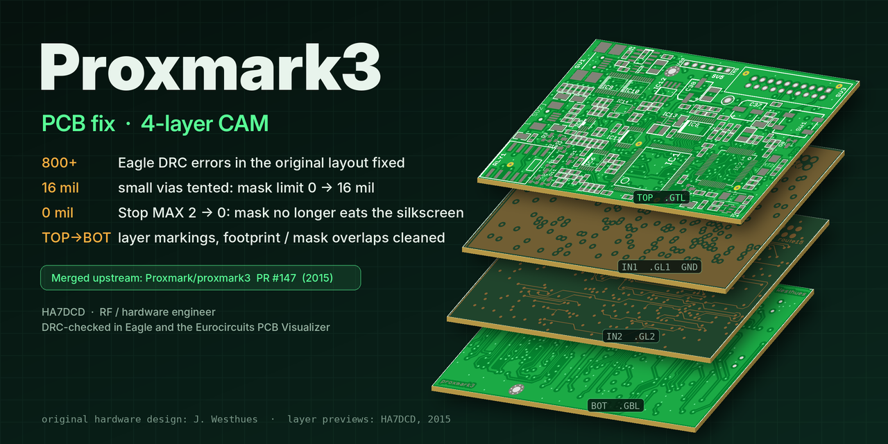

# HA7DCD – Zoltan Doczi

RF / hardware engineer and radio amateur from Hungary. Small RF boards, measurement-first hardware design, open hardware.

## Projects

### [QRPi_WSPR_PCB](https://github.com/ha7dcd/QRPi_WSPR_PCB) – Whispering Raspberries

A 20 m band, 20 dBm QRP transmitter shield for the Raspberry Pi. It takes the RF square wave the Pi generates on GPIO4 (or, experimentally, GPIO18) and turns it into a clean WSPR signal at 14.0971 MHz with a MOSFET stage and a multi-section low-pass filter. It was presented as a TAPR-DCC 2015 talk paper and was sold through TAPR and on Amazon.

The repository holds the original EAGLE design and Gerbers (rev 1.6), a KiCad 10 version checked against the original Gerbers and with 3D models, the DCC 2015 paper ([PDF](https://github.com/ha7dcd/QRPi_WSPR_PCB/blob/main/docs/DCC2015-QRPI-HA7DCD.pdf)) and the measured spectra.

### [proxmark3 – PCB fix](https://github.com/ha7dcd/proxmark3/tree/pcb/pcb) (merged upstream)

A cleaned-up 4-layer layout of Jonathan Westhues' original Proxmark3 RFID tool. The original EAGLE layout reported more than 800 DRC errors. The fix:

- vias smaller than 16 mil are tented (solder-mask limit 0 → 16 mil), so GND and signal vias are no longer left open next to pads
- Stop MAX 2 → 0 mil, so the solder-mask openings no longer cut into the silkscreen; the board house applies its own mask expansion
- the board's parts exported to a library and their footprints edited where the silkscreen overlapped the top solder mask
- TOP / IN1 / IN2 / BOT layer markings on the board, re-generated 4-layer CAM files
- DRC-checked in EAGLE and in the Eurocircuits PCB Visualizer; the original CAD/CAM files and the LF antenna CAM set are kept next to it

Merged into the main Proxmark repository as [Proxmark/proxmark3 PR #147](https://github.com/Proxmark/proxmark3/pull/147) (2015).

## Links

- Web: [rfsparkling.com/qrpi](https://rfsparkling.com/qrpi/)

73 de HA7DCD
